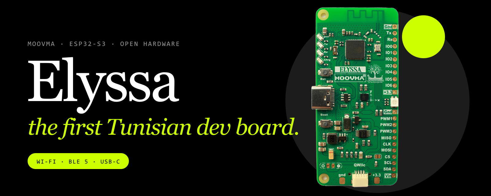
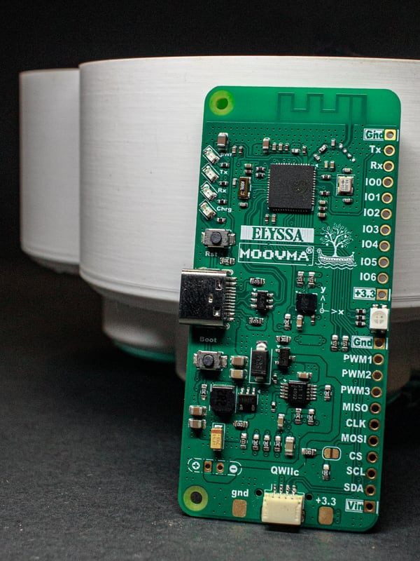
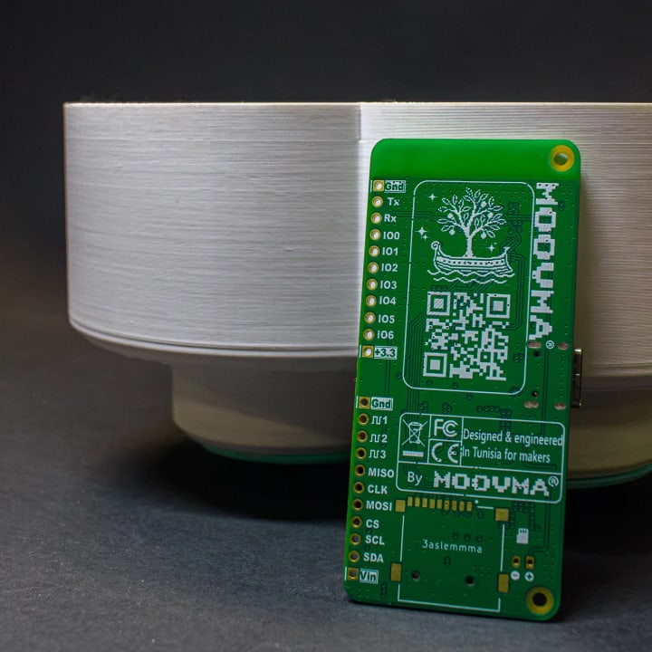
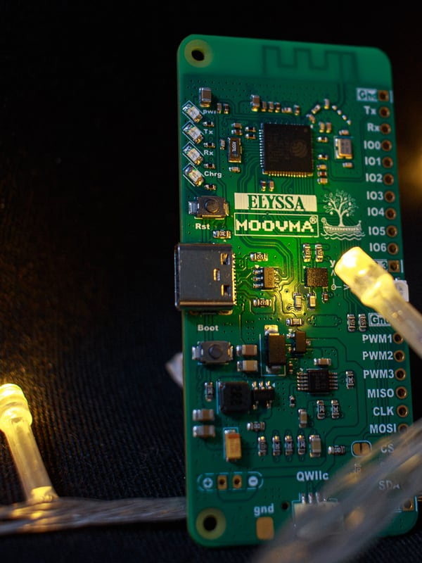
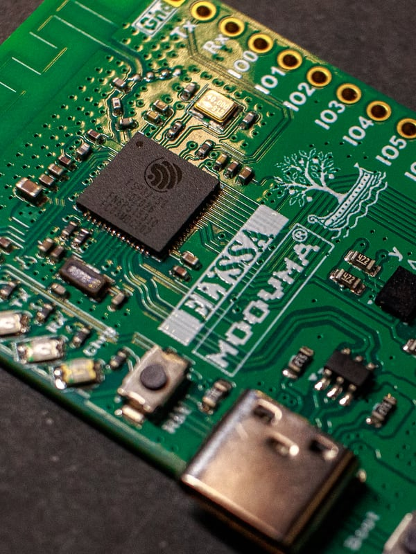
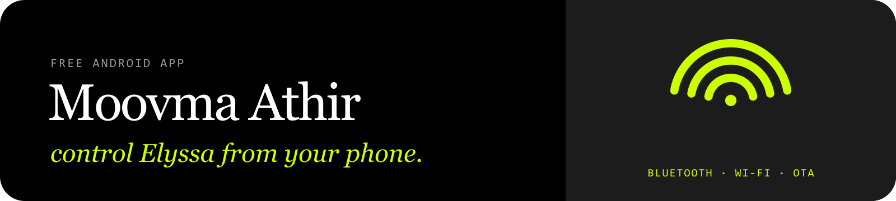

<div align="center">



<br>

<a href="https://moovma-git-main-moovma.vercel.app"></a>
<a href="https://github.com/moovma/moovma-athir-download/releases/download/v0.1.0/Moovma-Athir-0.1.0.apk"></a>
<a href="#quick-start-5-minutes"></a>
<a href="#pinout"></a>

<sub>*na3mlou MoovMa sa7bi #*</sub>

</div>

---

## What is Elyssa?

Elyssa is a small, friendly development board made by [Moovma](https://moovma-git-main-moovma.vercel.app) for makers,
students and engineers. Plug it in with one USB-C cable, program it from the Arduino IDE, and control it from your
phone. It is built around the **ESP32-S3FN8**.

| | |
|---|---|
| **Brain** | ESP32-S3FN8: dual-core 240 MHz, 8 MB embedded flash (no PSRAM) |
| **Wireless** | Wi-Fi and Bluetooth LE 5 |
| **USB** | Native USB-C: programming and serial monitor over one cable |
| **Built-in** | RGB LED (separate red, green, blue), 6-axis motion sensor (accelerometer + gyroscope), BOOT button |
| **Storage** | microSD slot on its own SPI bus |
| **Pins** | 7 analog / touch / digital pins, I2C, SPI, UART, PWM, plus a Qwiic connector |
| **Power** | LiPo charger (BQ24092) and optional battery voltage measurement |
| **Software** | Arduino IDE support with built-in RGB LED and motion sensor functions |

<table>
  <tr>
    <td width="25%"></td>
    <td width="25%"></td>
    <td width="25%"></td>
    <td width="25%"></td>
  </tr>
  <tr align="center">
    <td><sub>FRONT</sub></td><td><sub>BACK</sub></td><td><sub>IN THE LIGHTS</sub></td><td><sub>ESP32-S3 + USB-C</sub></td>
  </tr>
</table>

## Control Elyssa from your phone: Moovma Athir

<a href="https://github.com/moovma/moovma-athir-download/releases/download/v0.1.0/Moovma-Athir-0.1.0.apk"></a>


**Moovma Athir** is the free Android app made for Elyssa. Connect over Bluetooth or Wi-Fi and use ready-made
interfaces: remote robot car, drone / plane controller, motion sensor with a 3D board, messenger, light switch.
Each interface comes with a sketch you can copy into Elyssa and change. It also updates your board's firmware over
the air (OTA). English, French and Tunisian Arabic. No account needed.

**[Download the app (APK)](https://github.com/moovma/moovma-athir-download/releases/download/v0.1.0/Moovma-Athir-0.1.0.apk)**
· [All releases](https://github.com/moovma/moovma-athir-download/releases)

Install: open the downloaded file, allow "install unknown apps" when Android asks, tap Install.
No board yet? Turn on **Settings > Preview mode** in the app to try everything with a simulated Elyssa.

## Quick start (5 minutes)

### 1. Install the board package

1. Install [Arduino IDE 2](https://www.arduino.cc/en/software).
2. Open **File → Preferences** and paste this URL in **Additional boards manager URLs**:

   ```
   https://raw.githubusercontent.com/yassinechouk/Elyssa-dev-board/main/elyssa-arduino/package_moovma_elyssa_index.json
   ```

3. Open **Tools → Board → Boards Manager**, search **Moovma**, and click **Install** (the package contains the Elyssa board).

**Linux / macOS:** install Python 3.

### 2. Connect the board

1. Plug the board in with a USB-C **data** cable.
2. Select **Tools → Board → Moovma → Elyssa**.
3. Select **Tools → Port →** the port labelled **Elyssa**.

Keep the other **Tools** options at their default values.

### 3. Upload your first sketch

1. Open **File → Examples → 01.Basics → Blink**.
2. Click **Upload**. The on-board LED starts blinking.

> **If the upload fails:** put the board in download mode by hand: **hold BOOT, press and release RESET, then
> release BOOT**. Select the port that appears and click **Upload** again. This is usually needed only once.

**Serial Monitor:** open **Tools → Serial Monitor**. Press **RESET** to see the first messages.

**Compile times:** the first compile of a new sketch is the slowest (about 40 to 90 s on our Windows test PC, longer
with big libraries such as Wi-Fi or Bluetooth). Compiling the same sketch again takes about 7 to 9 s. The first
compile after installing a new package version also rebuilds the ESP32 core once (1 to 4 minutes). See
[TIPS_AND_KNOWN_ISSUES.md](TIPS_AND_KNOWN_ISSUES.md#compile-times) to speed it up.

### 4. Make it talk to the app

Open the app, pick an interface (for example **Light**), tap **Get the code**, copy the sketch into the Arduino IDE
and upload it. For firmware updates without a cable, use **Board → Update firmware** in the app: it writes the
one-time "OTA-ready" sketch for you.

---

## Pinout

Names follow the **silkscreen** of the board. All of them are available in sketches without any `#include`.

| Function | Names in sketches | GPIO | Notes |
|---|---|---|---|
| Header IO0 to IO6 | `IO0` ... `IO6`, `A0` ... `A6`, `T0` ... `T6` | 1 to 7 | analog (ADC1, works with Wi-Fi on), touch, digital |
| I2C (header + Qwiic) | `SDA`, `SCL` (`A8`/`A9`, `T8`/`T9`) | 8, 9 | 4.7 kΩ pull-ups on the board |
| UART (header) | `TX`, `RX` | 43, 44 | |
| SPI (header) | `SS` (`CS`), `MOSI`, `SCK` (`CLK`), `MISO` | 34, 35, 36, 37 | default `SPI` bus |
| microSD (separate SPI bus) | `SD_CS`, `SD_MOSI`, `SD_SCK`, `SD_MISO` | 10, 11, 12, 13 | |
| PWM | `PWM1`, `PWM2`, `PWM3` | 14, 47, 48 | `PWM1` is also touch pin `T10` |
| RGB LED | `LED_RED`, `LED_GREEN` (`LED_BUILTIN`), `LED_BLUE` | 39, 38, 33 | active high |
| BOOT button | `BOOT_BUTTON` | 0 | LOW when pressed |
| Battery voltage | `BAT_SENSE` | 7 | same pin as `IO6`; only if solder jumper **JP3** is bridged |
| IMU (internal I2C bus) | `SDA_gyro`, `SCL_gyro`, `INT_gyro` | 17, 18, 21 | address 0x6A, `Wire1` uses these pins |

There is no `A7` and no `T7`. The internal flash pins are not exposed. The website has a pin-safety guide
(which pins are safe to use, which need care): [Elyssa docs](https://moovma-git-main-moovma.vercel.app/docs#pin-safety).

<details>
<summary><b>Small code examples</b> (touch, analog, PWM, I2C, microSD, battery)</summary>

```cpp
Serial.println(touchRead(T10));                 // touch: T0..T6, T8, T9, T10
Serial.println(analogRead(A0));                 // analog: 0..4095
Serial.println(analogReadMilliVolts(A1));       // analog, calibrated, in mV
analogWrite(PWM1, 128);                         // PWM: 50 % duty
if (digitalRead(BOOT_BUTTON) == LOW) { }        // BOOT button
```

I2C (header or Qwiic):

```cpp
#include <Wire.h>
Wire.begin();                                   // SDA = GPIO8, SCL = GPIO9
```

microSD (own SPI bus, not the one on the header):

```cpp
#include <SPI.h>
#include <SD.h>
SPIClass sdSPI(HSPI);
sdSPI.begin(SD_SCK, SD_MISO, SD_MOSI, SD_CS);
SD.begin(SD_CS, sdSPI);
```

Battery voltage (only with **JP3** bridged; do not use `IO6` for anything else then):

```cpp
float vbat = analogReadMilliVolts(BAT_SENSE) * 2 / 1000.0;   // BAT_SENSE = VBAT / 2
```

The battery charger has no GPIO: its CHG output only drives the red charge LED.

</details>

---

## Built-in features

### RGB LED

Built into the board package: no `#include` needed.

```cpp
setLedColor(ELYSSA_GREEN);     // ELYSSA_OFF, RED, GREEN, YELLOW, BLUE, MAGENTA, CYAN, WHITE
setLedRGB(255, 80, 0);         // any mix, 0..255 per channel
```

| Channel | Pin |
|---|---|
| Red | `LED_RED` = GPIO39 |
| Green | `LED_GREEN` = GPIO38 (`LED_BUILTIN`, so Blink works) |
| Blue | `LED_BLUE` = GPIO33 |

The LED is off when a sketch starts. It lights up red while a sketch is being uploaded: this is normal (see
[TIPS_AND_KNOWN_ISSUES.md](TIPS_AND_KNOWN_ISSUES.md#red-during-upload)).

### Motion sensor (IMU)

The board has an STMicroelectronics LSM6DS3TR-C: accelerometer (in g) and gyroscope (in degrees per second). The
basic functions are built into the board package, with no `#include`:

```cpp
void setup() {
  Serial.begin(115200);
  if (!elyssa_imu_begin()) Serial.println("IMU not found");
  elyssa_imu_enable_tap();
}

void loop() {
  float x, y, z;
  elyssa_imu_read_accel(x, y, z);
  Serial.printf("x %.2f  y %.2f  z %.2f g\n", x, y, z);
  if (elyssa_imu_tapped()) setLedColor(ELYSSA_GREEN);
  delay(10);
}
```

Basic functions: reading (acceleration, rotation, temperature), ranges, sample rate, low power, pitch / roll /
orientation, gyroscope calibration, tap and double tap, free-fall, motion, step counter, wake-up from deep sleep by
motion.

Advanced functions (recording, filters, self-test, accelerometer calibration, stillness, tilt, wrist tilt,
significant motion, interrupt pin...) are in the **ElyssaIMU** library, also included in the board package: add
`#include <ElyssaIMU.h>`.

Examples: **File → Examples → ElyssaIMU** (Basics and Advanced). Full reference:
[ElyssaIMU README](platform/libraries/ElyssaIMU/README.md). Known limitations:
[TIPS_AND_KNOWN_ISSUES.md](TIPS_AND_KNOWN_ISSUES.md). You can also see the motion in the app: the **Motion**
interface shows a 3D board, all the values and alerts such as free fall.

The IMU is read over I2C at 400 kHz. Live reading with `elyssa_imu_ready()` keeps up with every sample up to
833 Hz; above that, use the recording (FIFO) functions of the ElyssaIMU library.

---

## Reference

<details>
<summary><b>Arduino Tools menu (defaults)</b></summary>

| Menu | Value |
|---|---|
| Board | Elyssa |
| Port | Elyssa on COMx |
| USB Mode | USB-OTG (TinyUSB) |
| USB CDC On Boot | Enabled |
| USB Firmware MSC On Boot | Disabled |
| USB DFU On Boot | Disabled |
| Upload Mode | USB-OTG CDC (TinyUSB) |
| CPU Frequency | 240MHz (WiFi) |
| Flash Mode | QIO 80MHz (the only choice) |
| Flash Size | 8MB (64Mb) |
| Partition Scheme | 8M with spiffs (3MB APP/1.5MB SPIFFS) |
| PSRAM | Disabled |
| Core Debug Level | None |
| Erase All Flash Before Sketch Upload | Disabled |
| JTAG Adapter | Disabled |

</details>

<details>
<summary><b>USB modes</b> (everyday and debug / JTAG)</summary>

| | Mode 1 - Everyday (default) | Mode 2 - Debug (JTAG) |
|---|---|---|
| USB Mode | USB-OTG (TinyUSB) | Hardware CDC and JTAG |
| Upload Mode | USB-OTG CDC (TinyUSB) | UART0 / Hardware CDC |
| JTAG Adapter | Disabled | Integrated USB JTAG |

**Mode 1 → Mode 2:** 1. **USB Mode → Hardware CDC and JTAG**, 2. **Upload**, 3. **Upload Mode → UART0 / Hardware
CDC**, 4. **JTAG Adapter → Integrated USB JTAG**.

**Mode 2 → Mode 1:** 1. **USB Mode → USB-OTG (TinyUSB)**, 2. **Upload**, 3. **Upload Mode → USB-OTG CDC (TinyUSB)**,
4. **JTAG Adapter → Disabled**.

If an upload fails: **hold BOOT, press and release RESET, release BOOT**, then **Upload** again.

</details>

## Troubleshooting

| Problem | What to do |
|---|---|
| **Moovma** is not in the Boards Manager | Check the URL in **File → Preferences**. If it was added recently, close the IDE and delete `package_moovma_elyssa_index.json` from the `Arduino15` folder (Windows: `%LOCALAPPDATA%\Arduino15`), then reopen the IDE. |
| Upload fails or the port disappears | Download mode by hand: hold **BOOT**, press **RESET**, release **BOOT**, select the new port, upload again. Use a USB-C **data** cable. |
| The Serial Monitor stays empty | Press **RESET**. Keep **USB CDC On Boot = Enabled**. Open the monitor at the baud rate of `Serial.begin()`. |
| The red LED is on during an upload | Normal, see [TIPS_AND_KNOWN_ISSUES.md](TIPS_AND_KNOWN_ISSUES.md#red-during-upload). |
| `multiple definition of lsm6ds3tr_c_...` | Another installed library contains ST's LSM6DS3TR-C driver. Remove it: the board package already includes it. |
| The IMU is not found, or `Wire1` and the IMU conflict | Call `Wire1.begin(SDA1, SCL1, 400000)` **before** `elyssa_imu_begin()`. |
| `T10` and `PWM1` do not work together | They are the same pin (GPIO14): use it for touch **or** for PWM. |
| The first compile is very slow | Normal for a new sketch. See [Compile times](TIPS_AND_KNOWN_ISSUES.md#compile-times). |
| "Invalid FQBN" after an update | Select the board again in **Tools → Board → Moovma → Elyssa**. |
| The app cannot find the board | Make sure the sketch contains MoovmaLink (the app's sketches do). Join the **Elyssa-XXXX** Wi-Fi, or allow Bluetooth and Location (needed by Android to scan). |

More details and known issues: [TIPS_AND_KNOWN_ISSUES.md](TIPS_AND_KNOWN_ISSUES.md).
Still stuck? Write to **moovmabh@gmail.com**.

## What has been tested

Tested on Elyssa v5:

- Upload in both USB modes, Blink, Serial Monitor
- RGB LED (all colours and `setLedRGB()`)
- IMU: reading, angles, orientation, tap, double tap, free-fall, motion, steps, wake-up from deep sleep (61 of 61 checks)
- ElyssaIMU library: 90 of 93 checks (the 3 failures are the wrist-tilt issue listed in
  [TIPS_AND_KNOWN_ISSUES.md](TIPS_AND_KNOWN_ISSUES.md))
- Touch on `IO0` to `IO5` and `T10`, BOOT button
- Pin constants of `pins_arduino.h` (self-test)
- Wi-Fi: scan, connect, ping, 21 to 23 Mbit/s, 2-minute stability, at the 11 dBm limit set by the package (see
  [TIPS_AND_KNOWN_ISSUES.md](TIPS_AND_KNOWN_ISSUES.md#wi-fi-transmit-power-is-limited-to-11-dbm-since-113))
- Bluetooth LE: start, scan, advertising from -12 to +20 dBm, phone connection, Wi-Fi + Bluetooth together

Not tested on a board yet: microSD with a card, battery charging and `BAT_SENSE`, external I2C devices (header and
Qwiic), the `PWM2` / `PWM3` pins against the silkscreen, deep-sleep current. The Moovma Athir app has been tried with
its built-in simulated board, but not yet with a real Elyssa.

## Version history

| Version | Summary |
|---|---|
| 1.1.3 | Wi-Fi transmit power limited to 11 dBm on Elyssa v5 (reliable connection and full speed), compile fix for Linux and macOS |
| 1.1.2 | Faster compiles (precomputed bootloader and partition tables, no `merged.bin`), Flash Mode fixed to QIO |
| 1.1.1 | LED off at startup, `T10` touch pin, package name **Moovma** |
| 1.1.0 | RGB LED, IMU support (core functions + ElyssaIMU library), ST driver |
| 1.0.1 | Core arduino-esp32 3.3.12, esptool 5.3.1 |
| 1.0.0 | First release |

Details: [CHANGELOG.md](CHANGELOG.md).

## Links

- **Website:** <https://moovma-git-main-moovma.vercel.app> (product page, docs, pin safety, shop)
- **App:** [Moovma Athir for Android](https://github.com/moovma/moovma-athir-download/releases/download/v0.1.0/Moovma-Athir-0.1.0.apk)
- **Other Moovma projects:** [github.com/moovma](https://github.com/moovma)
- **Contact:** moovmabh@gmail.com
- **For AI assistants:** [AGENTS.md](AGENTS.md) has every pin, rule and quick answer in one place (also [llms.txt](llms.txt))

## For maintainers

How to build, test and publish a release, and what to redo when the ESP32 core is updated:
[docs/MAINTENANCE.md](docs/MAINTENANCE.md).

## License

MIT, see [LICENSE](LICENSE). ST's LSM6DS3TR-C driver (`platform/variants/elyssa/`) is BSD-3-Clause, see
`LICENSE_ST.txt` in the same folder.
